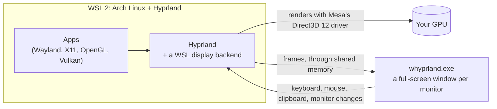

# whyprland: plain Hyprland on WSL with full GUI and Graphics

[](https://github.com/corexo/whyprland/actions/workflows/checks.yml)
[](https://github.com/corexo/whyprland/releases/latest)
[](LICENSE)

**A plain [Hyprland](https://hypr.land) desktop on Arch Linux, on Windows 11, one command away.** It runs in
[WSL](https://learn.microsoft.com/windows/wsl/about), full screen on every monitor, on your GPU. No dual
boot, no reboot: type `whyprland` at any Windows prompt to get the desktop, and log out to get your
prompt back.

whyprland is a fork of [womarchy](https://github.com/sytelus/womarchy) (Omarchy on WSL). It keeps
womarchy's WSL display backend, Mesa on Direct3D 12 and the Windows viewer, but ships plain Hyprland
from Arch instead of Omarchy: no Omarchy themes, no Omarchy menu.

## Highlights

- 🖥️ **Every monitor, full screen**, at its native resolution and the scale Windows uses for it. Plug in or rearrange monitors while it runs.
- 🚀 **On your GPU.** Hyprland composites on your graphics card; frames reach Windows through shared memory, without copies. OpenGL and Vulkan apps are GPU accelerated too.
- ⌨️ **One command in, log out to leave.** `whyprland` from any terminal, or **Whyprland** in the Start menu.
- 📋 **Clipboard both ways** (text and images), 🔊 **sound and microphone** through WSL.
- 🛟 **Updates you can undo.** `whyprland update` runs `pacman -Syu`; a rollback point is recorded first, and `whyprland rollback` puts the previous versions back.
- 🧹 **Leaves Windows alone.** No custom kernel, no global WSL settings. `whyprland uninstall` removes everything.

## Install

**You need:** Windows 11 and a GPU driver with WSL support (any current NVIDIA, AMD or Intel driver).

Open **PowerShell** (no need to run it as administrator) and paste:

```powershell
irm https://raw.githubusercontent.com/corexo/whyprland/main/install.ps1 | iex
```

The installer explains what it will do and asks before changing anything. It then:
1. installs or updates WSL if needed (WSL 3.0.1 or later; this restarts WSL for all your distros);
2. downloads `whyprland.exe` and the Whyprland image;
3. asks you to choose a user name and password.

## Use

| | |
|---|---|
| Start the desktop | **Whyprland** in the Start menu, or `whyprland` in a terminal |
| Back to Windows | Log out of Hyprland, or **Ctrl+Alt+End** to minimise |
| Update | `whyprland update` (`pacman -Syu` inside the distro) |
| Undo the last update | `whyprland rollback` |
| Back up / restore everything | `whyprland backup` / `whyprland restore` |
| Check the installation | `whyprland status` |
| Remove everything | `whyprland uninstall` |

Windows keeps **Win+L** and **Ctrl+Alt+Del** for itself. Problems? See [Troubleshooting](docs/TROUBLESHOOTING.md).

> [!WARNING]
> **Work in progress.** Expect rough edges, and please
> [tell us](https://github.com/corexo/whyprland/issues/new/choose) how it went. whyprland adds a WSL distro
> named "Whyprland", a Start menu entry and the `whyprland` command for your user. Nothing else on Windows changes.

## How it works



Hyprland normally needs display hardware, which WSL doesn't have. A display backend (from womarchy) hands
each finished frame to `whyprland.exe` on Windows through memory both sides can see. `whyprland.exe` shows
each monitor's frames in a full-screen window and sends keyboard, mouse and clipboard events back.
Details: [architecture](docs/ARCHITECTURE.md), [development](docs/DEVELOPMENT.md), [patches](patches/README.md),
and womarchy's [journey](docs/JOURNEY.md).

## Contributing

[Open an issue](https://github.com/corexo/whyprland/issues/new/choose) for bugs, ideas or test reports.
See [CONTRIBUTING.md](CONTRIBUTING.md). Security problems: [SECURITY.md](SECURITY.md).

## Credits

whyprland is a fork of [womarchy](https://github.com/sytelus/womarchy) by sytelus, which did all the hard
work of getting Hyprland onto WSL. It stands on [Hyprland](https://hypr.land), [Arch Linux](https://archlinux.org),
[Mesa](https://mesa3d.org) and [WSL](https://github.com/microsoft/WSL) with [WSLg](https://github.com/microsoft/wslg).
Our patches to them are in [patches/](patches/).

## License

MIT (see [LICENSE](LICENSE)). The patches keep their upstream projects' licenses; the Arch packages in the
image are under their own licenses.
